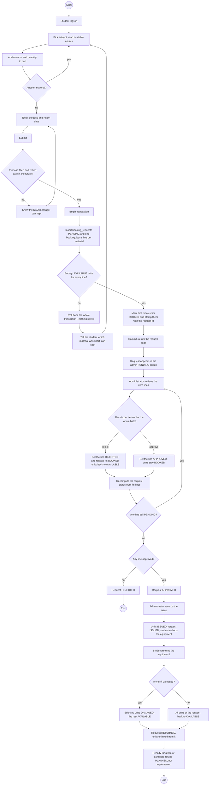

# Activity Diagram

The booking lifecycle as the code actually runs it: `BookingDao.submit` → `decideItem` / `decideRequest` → `recordIssue` → `recordReturn`.
Both failure branches required by the README are shown: **insufficient stock rolls the whole submission back**, and **a rejection frees the units it was holding**.

**Notes tying the diagram to the code**

- The status recomputation box is `BookingDao.syncRequestStatus`: while any line is `PENDING` the header is left alone, otherwise it becomes `APPROVED` if any line was approved, else `REJECTED`. A request can therefore never be approved with every line rejected.
- `ISSUED` and `RETURNED` are written outright by `recordIssue` / `recordReturn`, not computed — which is why the admin buttons guard on the current status.
- A damaged unit is later put back into circulation by the separate *Mark repaired* action, not by this flow.
