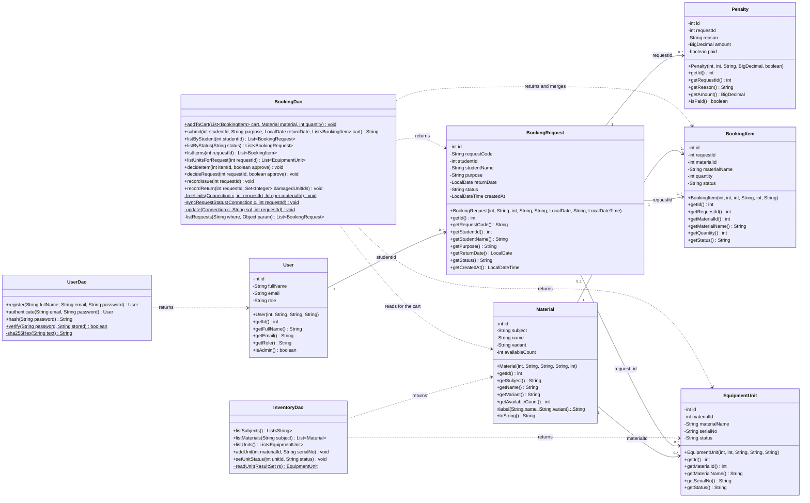

# Class Diagram

The nine implemented classes of Phase 3 — six models in `com.labbooking.model` and three DAOs in `com.labbooking.dao` — with their real attributes and methods. All model fields are `private final`; all models are immutable and expose getters only.

**Derived attributes** — four fields are *not* columns of any table. They are filled by a `JOIN` or an aggregate in the DAO query so a table row needs no extra query, and they are therefore derived attributes of the Java classes only:

| Class | Attribute | Derived from |
|---|---|---|
| `Material` | `availableCount` | `COUNT(equipment_units WHERE status = 'AVAILABLE')` |
| `EquipmentUnit` | `materialName` | `JOIN materials` |
| `BookingItem` | `materialName` | `JOIN materials` |
| `BookingRequest` | `studentName` | `JOIN users`, for the administrator's queue |

**Notes**

- `$` marks a static member, `~` package-private, `-` private, `+` public (Mermaid notation).
- The associations above are navigable **by foreign-key value, not by object reference**: no model holds a collection or a pointer to another model. `BookingRequest` has no `List<BookingItem>` field; the DAO fetches item lines with `listItems(requestId)`. This keeps the models flat, exactly as the tables are.
- Statuses are plain `String`s matching the database `ENUM`s, so there are no status enum classes.
- `Penalty` is implemented but **not yet used** by any DAO or screen (penalties are Planned).
- Not shown, because they are infrastructure rather than domain classes: `Main` (JavaFX `Application` plus the static session), `Database` (JDBC connection helper) and the four `ui` views `LoginView`, `RegisterView`, `StudentView`, `AdminView`, which call the three DAOs.

**Cross-check (Phase 8 requirement):** every attribute, method name, parameter list and return type above was read out of the `.java` files in `src/main/java/com/labbooking/model/` and `/dao/`. `throws SQLException` is omitted from the DAO signatures for readability; every DAO method except `addToCart`, `hash`, `verify` and `sha256Hex` declares it.
