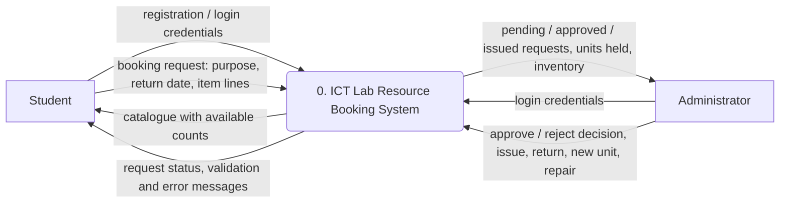
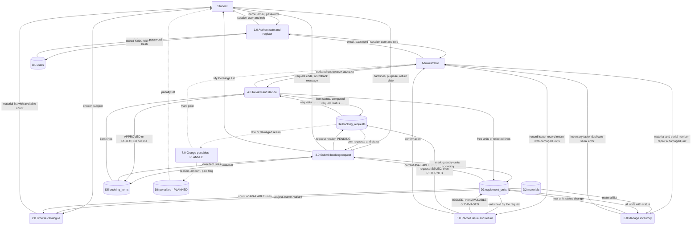

# Data Flow Diagram

ICT Lab Resource Booking System. Drawn from the implemented code (`src/main/java/com/labbooking/`) and `db/schema.sql`.

Notation: rectangles are external entities, rounded boxes are processes, cylinders are data stores.
Penalties are **Planned, not implemented** — `penalties` exists in the schema and `Penalty.java` exists, but no code reads or writes it (see the proposal, §11).

## Context level (Level 0)

## Level 1

