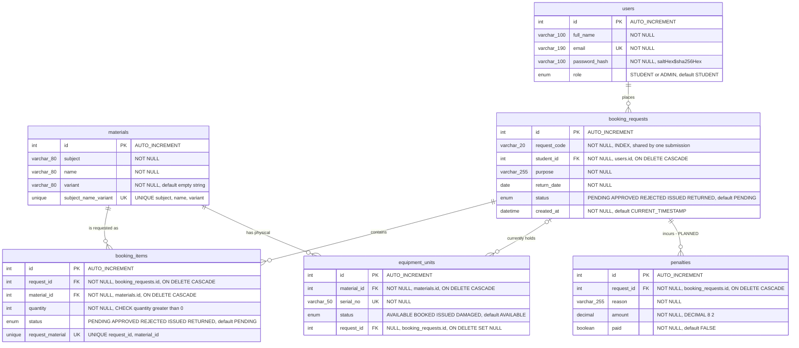

# Entity Relationship Diagram

The six tables of `db/schema.sql`, field for field. `PK` primary key, `FK` foreign key, `UK` unique constraint.

**Reading the cardinalities**

- A student places zero or more requests; every request belongs to exactly one student.
- A request contains one or more item lines, at most one line per material (`UNIQUE(request_id, material_id)`) — adding the same material twice raises the quantity instead.
- A material has zero or more physical units; `equipment_units.request_id` is nullable, so a unit belongs to at most one request at a time and is unlinked again on return.
- `penalties` is created by the schema but not used by any code yet (**Planned**).

**Cross-check (Phase 8 requirement):** every column, type, default, `UNIQUE`, `CHECK`, `INDEX` and `ON DELETE` rule above was read out of `db/schema.sql`. Mermaid attribute types cannot contain brackets, so `varchar(100)` is written `varchar_100` and the `ENUM` values live in the comment column.
