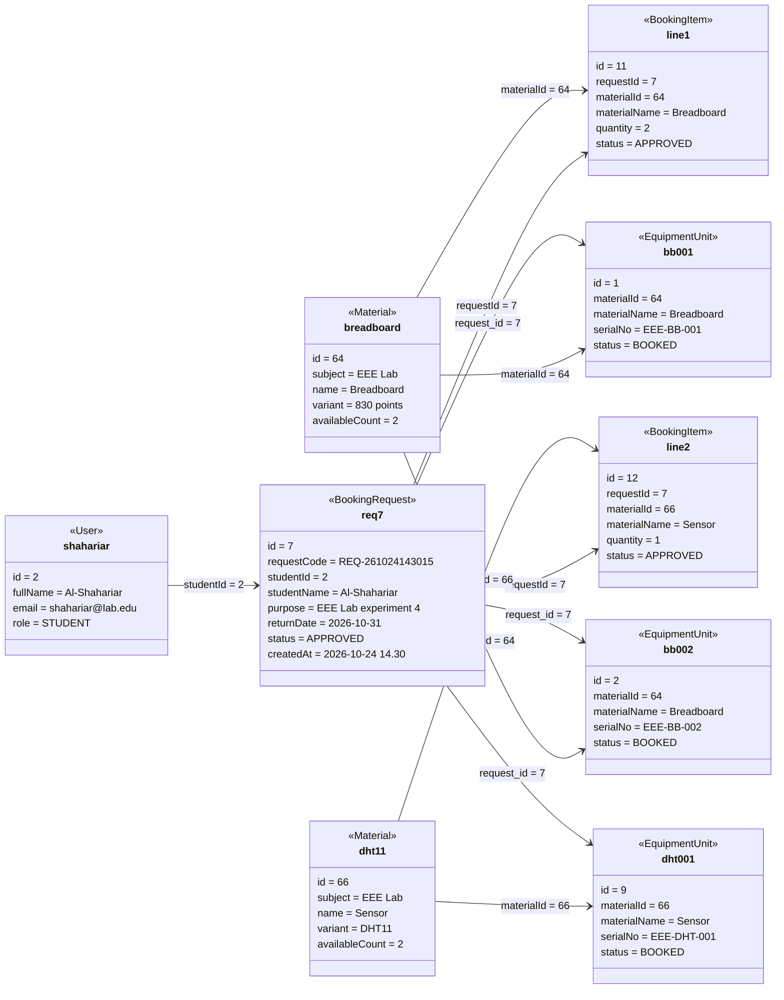

# Object Diagram

One concrete snapshot of the running system, consistent with [`class-diagram.md`](class-diagram.md) and with the demo data in `db/seed.sql`: the student **Al-Shahariar ** has submitted one request with **two item lines**, the administrator has approved it, and **three units** are held by it.

Mermaid has no object-diagram type, so each box below is one *instance*: the box name is the object name and the `<<Class>>` line is its class, in place of the UML `object : Class` underline.

**Why this snapshot is internally consistent**

- Two item lines, quantities 2 and 1 → exactly three units are held, which is what `BookingDao.submit` books.
- `breadboard.availableCount = 2`: the seed gives EEE Lab four breadboards; `EEE-BB-001` and `EEE-BB-002` are `BOOKED` by this request, leaving `EEE-BB-003` and `EEE-BB-004` available.
- `dht11.availableCount = 2`: of the seed's three `EEE-DHT-*` units, only `EEE-DHT-001` is held here.
- Both lines are `APPROVED` and no line is `PENDING`, so `syncRequestStatus` sets the request to `APPROVED` — the next legal action is *Record issue*, which turns all three units and the request to `ISSUED`.
- The request is listed at most once per material (`UNIQUE(request_id, material_id)`), so a second breadboard request would have raised `quantity` instead of adding a third line.

Material and unit ids follow the seed's insertion order: the 63 `IOT Lab` rows are inserted first, so EEE Lab's Breadboard is material 64 and its Sensor (DHT11) is material 66. The unit ids above are illustrative of that same ordering.

**One honest mismatch to note:** the last three links are database state, not Java fields. `equipment_units.request_id` is a column, but the `EquipmentUnit` class has no `requestId` attribute — `BookingDao.listUnitsForRequest(7)` is what resolves that link at runtime. The link is drawn because the snapshot would be unreadable without it.
