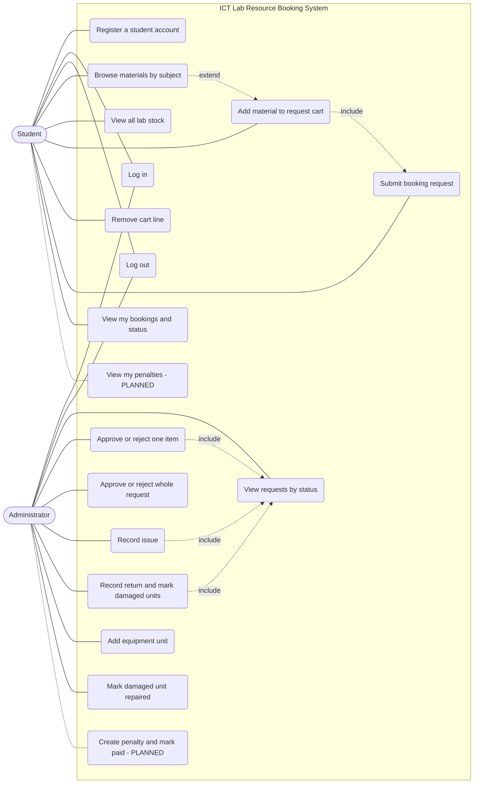

# Use Case Diagram

Actors and use cases of the implemented prototype (Phases 4–6). Everything inside the system boundary is working code except the two dashed penalty cases, which are **Planned**.

**Relationships worth reading off the diagram**

- *Log in* is shared: `LoginView` routes to `StudentView` or `AdminView` by `User.role`.
- *Submit booking request* includes the cart: `BookingDao.submit` refuses an empty cart, a blank purpose, or a return date that is not in the future.
- *Record issue* and *Record return* are guarded by the request's current status, so they can only follow an approval.
